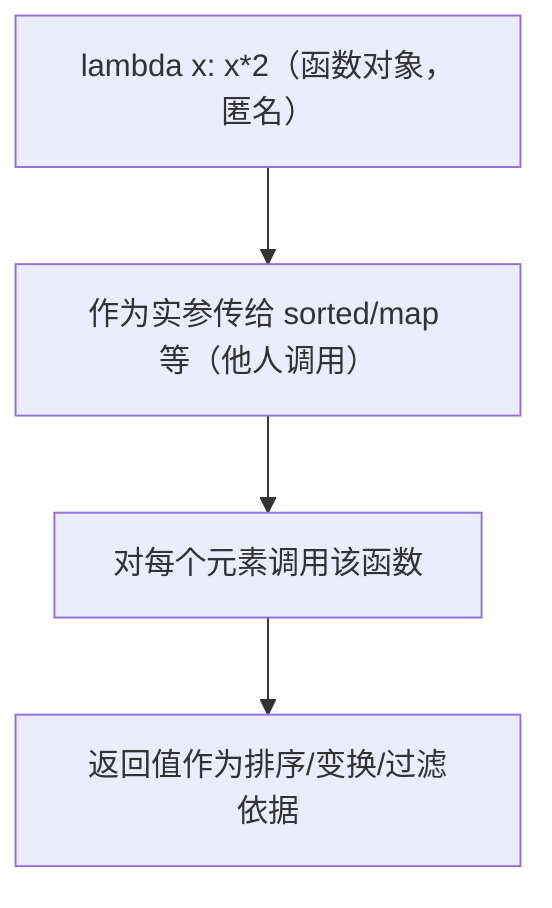
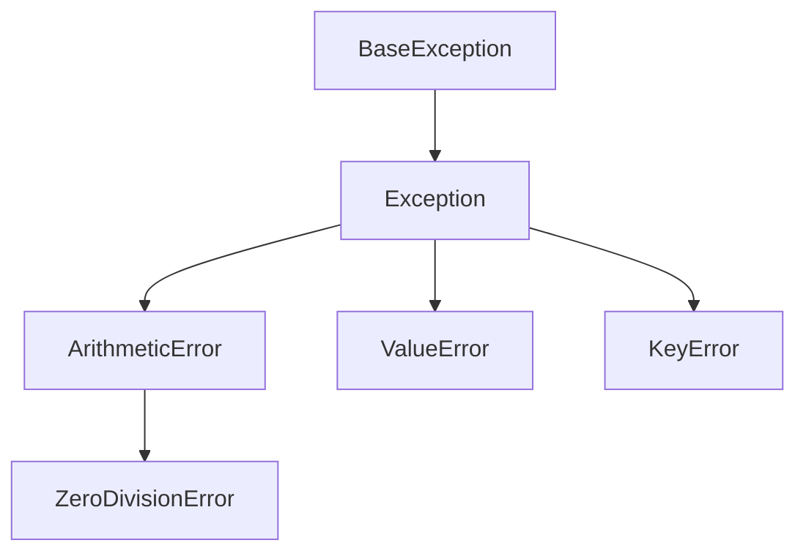

<!-- 片头 · 空镜 -->
## 匿名，却不无名；崩溃，却能兜住

---
layout: cover
---

# 第9讲 · 函数（续）
## lambda · 内置函数 · 异常处理

<!-- 讲者备注：【空镜】开场钩子。抛两个问题:上一讲的 def 能不能不取名字直接就用(→lambda);程序跑到一半崩了怎么自己兜住(→try/except)。一句提全课:一边给函数配"匿名快递员",一边给程序上"安全气囊"。节奏:先 lambda,再 sorted/map/filter,最后异常三连。 -->

---
transition: slide-left
---

# 这一讲，你会收获四件事

- 匿名函数：`lambda 参数: 表达式`
- 一把快排：`sorted` / `map` / `filter`
- 安全气囊：`try` / `except` / `else` / `finally`
- 结果 + 置信度：多返回值

<!-- 讲者备注：【全景】抛路线图,只给骨架。教学目标:学完能构造 lambda 并理解匿名执行原理;会用 sorted/map/filter 处理数据;会用 try/except/else/finally 严谨捕获异常;能用多返回值输出"预测结果+置信度"。 -->

---
layout: section
---

## 第一幕 · 匿名函数 lambda

<!-- 转场
讲者备注：【转场】幕卡,淡入切幕。一句话预告本幕:不想为一行逻辑单独起名,就用 lambda 就地"造一个无名函数"。它在哪?在别人(如 sorted)的手里被调用。 -->

---

# lambda：不取名的人民公敌

```python
add = lambda a, b: a + b       # 等价于 def add(a, b): return a + b
print(add(3, 4))               # 7

funcs = [lambda x: x + 1, lambda x: x * 2]
print(funcs[0](5), funcs[1](5))   # 6 10
```

- 只含**一个表达式**，自动返回其结果（不能 `return`、不多条语句）
- 得到的仍是**普通函数对象**，能赋值、传参、进列表

<!-- 讲者备注：【特写】先给语法:lambda 参数: 表达式。强调三条限制:单表达式、自动返回值、匿名。将 funcs 放列表说明它就是普通函数对象。对比混着加一条 def 版,一眼看懂等价。 -->

---

# lambda 的真实价值：当快递员

```python
pairs = [("b", 2), ("a", 4), ("c", 1)]
print(sorted(pairs, key=lambda t: t[1]))
# [('c', 1), ('b', 2), ('a', 4)]  ← 按第二个元素排
```

> 问：lambda 还没名字，怎么知道给谁排序？
> 答：`sorted` 会对每个元素调用这个匿名函数，用返回值当排序依据——被人调用的函数，无名也能干。

<!-- 讲者备注：【特写】lambda 价值不在"懒得起名",而在就地定义、就地传给别的函数。sorted 的 key 参数收的就是一个函数。一句话点醒:它是被人调用的快递员,所以叫匿名仍能工作。 -->

---

# 执行原理：它只是"一个函数对象"



- `lambda` 是**表达式**，求值出来就是个**函数对象**
- "匿名" = 不绑名字，由用时的人调它

<!-- 讲者备注：【难点】把匿名到底怎么"被用"讲透。lambda 作为表达式求值得到函数对象,在整个生命周期里都由别人(sorted/map/filter)在合适的时机调用。一旦你临时赋值给变量,它就不再匿名了。 -->

---
layout: section
---

## 第二幕 · 内置函数与多返回值

<!-- 转场
讲者备注：【转场】幕卡,淡入切幕。一句话预告本幕:lambda 配上了三个小弟——sorted 排序、map 变换、filter 过滤——再加上多返回值,让"结果+置信度"一把到位。 -->

---

# sorted：按谁的规则排队

```python
ages = [22, 18, 30, 16, 25]
print(sorted(ages))                    # [16, 18, 22, 25, 30]
print(sorted(ages, reverse=True))      # [30, 25, 22, 18, 16]

temps = [("哈尔滨", 2), ("上海", 28), ("厦门", 32)]
print(sorted(temps, key=lambda t: t[1], reverse=True))
# [('厦门', 32), ('上海', 28), ('哈尔滨', 2)]
```

> `sorted` 返回**新列表**；`ages.sort()` 是原地改，别混

<!-- 讲者备注：【特写】sorted 三参数:iterable、key=函数、reverse=布尔。重点:key 后面跟的正是匿名函数,它是"按什么排"的规则。对比一句:ages.sort() 原地排序返回 None,sorted 返回新列表不动原数据。 -->

---

# map / filter：逐个改造，逐一挑选

```python
nums = [1, 2, 3, 4]
print(list(map(lambda x: x * x, nums)))   # [1, 4, 9, 16]
print(list(map(str, nums)))               # ['1', '2', '3', '4']

a = [22, 18, 30, 16, 25]
print(list(filter(lambda x: x >= 18, a))) # [22, 18, 30, 25]
```

> `map`/`filter` 返回**迭代器**，要 `list()` 转成列表才能打印

<!-- 讲者备注：【特写】给 map 配"都平方"、给 filter 配"都要成年"。两者都是把匿名函数作用到每个元素,match 出变换的结果/保留的成员。叮咛:返回值是迭代器,list() 再打印。 -->

---

# 多返回值：结果 + 置信度（AI 赋能）

```python
def predict(score):
    pred = "通过" if score >= 60 else "不通过"
    conf = min(score / 100, 0.99) + 0.01   # 简化置信度
    return pred, conf            # 返回元组

result, confidence = predict(85)
print(f"预测: {result}, 置信度: {confidence:.2f}")
```

- `return a, b` 实际返回**元组**，一行解包
- 模型推理常给"结论 + 置信度"，再 `sorted(key=..., reverse=True)` 出 top-K

<!-- 讲者备注：【特写】本讲 AI 落点。把函数的 return 升级成"结论+置信度"：一行解包成两个变量。这正是模型推理的常见画风——不只给结论,还给把握多大。配合 sorted 可排 top-K。 -->

---
layout: section
---

## 第三幕 · 异常处理

<!-- 转场
讲者备注：【转场】幕卡,淡入切幕。一句话预告本幕:程序会崩,但严谨的工程师先预判错误、再用 try/except 兜住,而不任它停摆。三个关键词:try 试探、except 兜、finally 善后。 -->

---

# 崩溃，是企业的安全缺口

- 未处理异常 → 程序**中断退出**，后续全停、数据丢失、服务不可用
- 严谨工程：**预判出错 → 判定并接收异常**，而非任它崩溃

```python
def safe_div(a, b):
    try:
        return a / b
    except ZeroDivisionError:
        return "除数不能为 0"

print(safe_div(10, 0))   # 除数不能为 0 —— 没崩
```

<!-- 讲者备注：【思政】先立"崩溃=安全缺口"价值观:企业里崩溃会是数据丢失、服务停摆、被攻击的缺口。引 safe_div:一句 try 把程序救回来。强调:预判+接收异常,是保护系统安全的第一步。 -->

---

# try / except / else / finally

```python
def f(v):
    try:
        r = int(v)
    except ValueError:
        print("不是数字")
    else:
        print("转换成功，值为", r)
    finally:
        print("finally 总会执行")
```

- `except`：有异常才执行
- `else`：**没异常**才走（try 顺利走完）
- `finally`：**无论怎样**都执行（清理资源）

<!-- 讲者备注：【特写】四个兄弟的分工排清楚。except=出事了才走;else=没出事才走;finally=不管出不出事都走(关文件、释放资源)。两个调用例子讲一遍:f("123") 走 else+finally,f("abc") 走 except+finally。 -->

---

# 异常是"类"，子类在前父类在后



```python
try:
    1 / 0
except ZeroDivisionError:      # 子类在前
    print("除零了")
except ArithmeticError:        # 父类在后
    print("算术错误")
```

<!-- 讲者备注：【难点】异常不是字符串,是"类"且有继承树。except 按类及子类匹配;多分支要子类在前、父类在后,否则父类抢先接住。画树+给代码,让学生看 ZeroDivisionError 落在 ArithmeticError 之下就能被后者接住。 -->

---

# ⚠️ 裸 except 的隐患（思政点）

```python
try:
    int("abc")
except:               # KeyboardInterrupt、系统错误也被吞了
    print("出错了")
```

- **吞掉** Ctrl+C 等系统级中断，用户没法打断
- **掩盖 bug**：不知道错在哪，无从排查
- 系统性风险被静默吞掉 → 安全审计的缺口

> 正确姿势：能预判的用 `except Exception as e` 精准捕获子类；真无法预期的，最外层记录日志再兜底

<!-- 讲者备注：【思政】打下"别乱甩一张大网"的防线。except: 会连 KeyboardInterrupt、内存/系统错误一起吞,坏处三连:用户无法中断、bug 被掩盖、安全审计缺口。给正解:精准捕获子类;真兜不住,最外层记日志再处理。 -->

---

# 结课：严谨接收，才可靠

> 匿名函数 `lambda` 就地造，
> `sorted`/`map`/`filter` 一把快排，
> `try`/`except`/`else`/`finally` 撑起安全气囊，
> 多返回值回你"结果 + 置信度"。

🔜 下节预告：面向对象 —— 类、对象、封装、继承

<!-- 讲者备注：【空镜】收尾口诀 + 悬念。四句把 lambda、内置函数、异常、多返回值一剑收束,强调"严谨接收异常=可靠安全"。预告:下节进入面向对象,把相关的东西写进"类"这个模具里。致谢。 -->