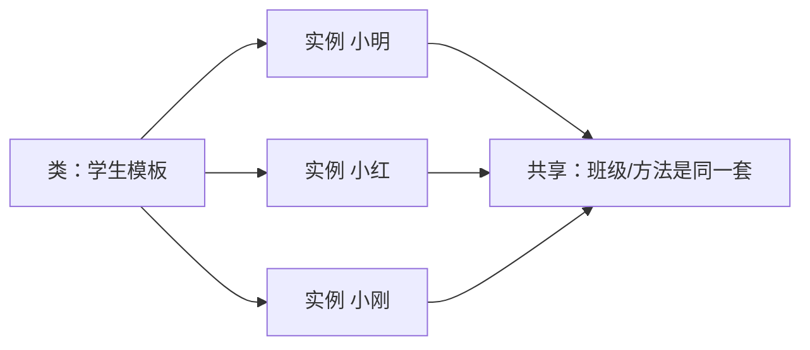

<!-- 片头 · 空镜 -->
## 一张学生登记表，套用全班的每一个人

---
layout: cover
---

# 第10讲 · 类与面向对象
## 一个模板，冲压出无数个个体

<!-- 讲者备注：【空镜】开场钩子。全班登记姓名/学号/班级,你会写多少个结构体?还不如做一份"登记表模板"套用到每个人。一个模板复制出很多份——这就是类与对象。本讲给四件武器:定义/实例化、__init__ 构造、self、实例/类属性,顺带把公有私有与"集体个体"的思政线带出来。 -->

---
transition: slide-left
---

# 这一讲，你会收获五件事

- 类 = 模板，实例 = 个体
- 定义与实例化：`class` + `类名(实参)`
- 构造函数 `__init__` 与 `self`
- 实例属性 vs 类属性
- 公有 vs "私有"（getter）

<!-- 讲者备注：【全景】抛路线图,只给骨架。教学目标:学完能说明面向对象思想(类=共性模板,实例=个性个体);会用 class 定义类并实例化调用属性和方法;能写 __init__ 并理解 self;能辨析实例/类属性;体会"集体与个体"互为成全的思政。 -->

---
layout: section
---

## 第一幕 · 模板与个体

<!-- 转场
讲者备注：【转场】幕卡,淡入切幕。一句话预告本幕:先立"类是模具、对象是工件"的心智,再用一个 Student 亲手定义、实例化、调用。 -->

---

# 类 = 模板，对象 = 实例

- **类（class）**：一份设计蓝图 / 模具，描述一类事物共有的属性和行为
- **实例（instance）**：用模具冲压出的一个个具体个体，各自数据不同



<!-- 讲者备注：【全景】立"模具"直觉:一个模具冲出无数工件,形状相同编号各异。学生共用一个登记表模板,填不同姓名就是不同学生。强调:类定义"长什么样、会干什么",实例才真正装数据。 -->

---

# 定义 + 实例化 + 调用（核心三连）

```python
class Student:
    school = "嘉庚学院"          # 类属性（共享）

    def __init__(self, name, age):   # 构造函数
        self.name = name             # 实例属性（个性）
        self.age = age

    def say_hello(self):             # 方法
        return f"我是{self.name}，来自{self.school}"

s1 = Student("小明", 20)      # 实例化：类名(实参)
s2 = Student("小红", 21)
print(s1.say_hello())          # 实例.方法()
print(s1.name)                 # 实例.属性
print(Student.school)          # 类名.类属性
```

<!-- 讲者备注：【特写】核心三连一镜讲完:class 定义、类名() 实例化、对象.方法/属性调用。叮咛 self 指向"正在调方法的那个对象"。这页信息量大,讲慢一点,逐行指。 -->

---
layout: section
---

## 第二幕 · 构造与属性

<!-- 转场
讲者备注：【转场】幕卡,淡入切幕。一句话预告本幕:每个对象一出生怎么拿到自己的数据?靠 __init__ 构造函数。数据分两类:大家共享的类属性,一人一份的实例属性。 -->

---

# __init__：一出生就初始化

```python
class Student:
    def __init__(self, name, age):
        self.name = name
        self.age = age

s = Student("小明", 20)
# 创建对象 = 把参数传进 __init__
print(s.name, s.age)    # 小明 20
```

- 每次 `Student(...)` **自动**调用一次 `__init__`
- `self` 就是"刚创建出来的那个对象本身"
- 作用：让每个实例一出生就有属于自己的数据

<!-- 讲者备注：【特写】__init__ 的三个要点:创建时自动执行、self 是刚造出的那个对象、作用是初始化。给一句口诀:类名加括号,参数进 __init__,self 是自己的本体。 -->

---

# ❗ 实例属性 vs 类属性

| | 类属性 | 实例属性 |
|---|---|---|
| 写在哪儿 | 类体内、函数外 | `__init__` 里 `self.x` |
| 属于谁 | 类（共享一份） | 每个实例（各自一份） |
| 访问 | `类名.x` / `对象.x` | `对象.x` |
| 改一处 | 影响所有实例 | 只影响该实例 |

> **"共性"放类里共享，"个性"放 `__init__` 里各不同**

<!-- 讲者备注：【难点】一张对照表把两类属性分家。核心是"共享 vs 独立":改类属性动所有实例,改实例属性只动那一个。给一句收束:共性归类、个性归实例。 -->

---
layout: section
---

## 第三幕 · 公有私有 · 思政

<!-- 转场
讲者备注：【转场】幕卡,淡入切幕。一句话预告本幕:数据不是都给外面随便摸的——公有公开用、私有走 getter。这一幕把"封装安全"和"集体个体"两条线收在一起。 -->

---

# 公有 vs "私有"：__x 名称修饰

```python
class Student:
    def __init__(self, name, sid):
        self.name = name          # 公有
        self.__sid = sid          # "私有"
    def get_sid(self):            # getter：公开通道
        return self.__sid

s = Student("小明", "2025001")
print(s.name)              # 直接读  ✔
print(s.get_sid())         # 走 getter ✔
print(s.__sid)             # ❌ AttributeError
```

- `__x` 不是铁锁，而是被改名为 `_类名__x`（名称修饰）
- 意义：**"请走正门"** 的约定，保护内部数据不被乱改

<!-- 讲者备注：【特写】讲清"私有"的真相:__sid 不是真正藏死,而是名字改成 _Student__sid。用 getter 提供公开通道。落点:这是约定不是铁锁——提醒合作者内部数据走公开方法。 -->

---

# ✨ 思政：集体与个体，互为成全

- 实例**共享**类的属性和方法 → 共同框架、共同目标（**集体**）
- 实例**拥有**独特私有数据 → 各自经历与创新（**个体**）

> 集体提供统一的行为规范与平台；尊重每个人独特的数据与个性。
> 💬 融入集体靠谱守规矩，同时鼓励独立思考、大胆创新——**集体与个体不是二选一，而是互为成全**。

<!-- 讲者备注：【思政】把"共性框架/个性差异"升华。类的方法与类属性=集体的规范与平台;实例属性与私有数据=个体的创新。落点一句:集体与个体互为成全。让同学结合班级举例讨论。 -->

---

# 常见错误：五个坑

| 想干嘛 | 坑 | 对的做法 |
|---|---|---|
| 定义方法 | 忘写 `self` | 方法第一参写 `self` |
| 调用方法 | `s.hello` 打印地址 | `s.hello()` |
| 每人独立数据 | 类体写 `name=None` | `__init__` 里 `self.name=` |
| 改类属性 | 误当个性改 | 分清实例/类属性 |
| 读私有 | `obj.__x` 报错 | 用 getter |

<!-- 讲者备注：【全景】五坑速查:忘 self、漏括号、实例属性写进类体、改类属性不当、硬摸私有。每个都能抛错给学生猜,再给正解。是评论区高频报错。 -->

---

# 结课：面向对象的大门才刚开

> 类做模板，实例装数据，
> `__init__` 一出生就初始化，
> 共性共享类属性，个性独享实例，
> 公有公开用，私有走 getter，封装保安全。

🔜 下节预告：类的继承与多态

<!-- 讲者备注：【空镜】收尾口诀 + 悬念。四句把模板/构造/两类属性/公有私有一剑收束,点出"集体与个体互为成全"的思政落点。预告:下节继承与多态,让子类复用父类共性。致谢。 -->