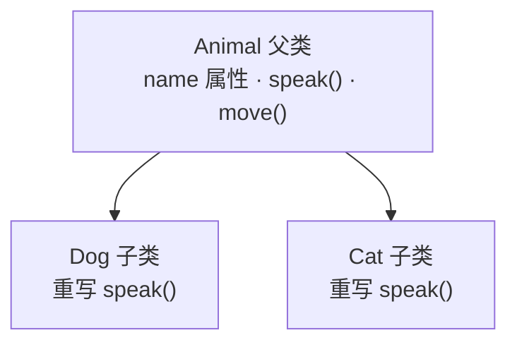
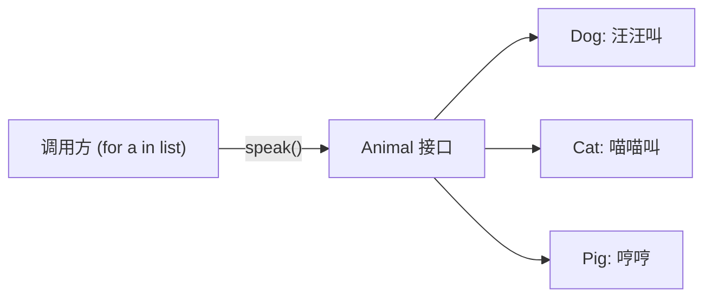

<!-- 片头 · 空镜 -->
## 动物千百种，「叫」「动」不必各写一遍

---
layout: cover
---

# 第11讲 · 类的继承性与多态
## 封装 · 继承 · 多态 —— 三大特性收尾

<!-- 讲者备注：【空镜】开场钩子。动物有很多种,是不是每一类都要重写「叫」「动」?不用——把共性放父类,子类继承复用。本讲四件事:继承(类套类)、重写(子类改造)、多态(同一接口不同实现)、模块导入(把类拆进 .py 复用),最后落到 AI 模型的 train/predict 接口范式。节奏:先继承复用,再 super 构造,多态扩展,模块组织。 -->

---
transition: slide-left
---

# 这一讲，你会收获五件事

- 继承：`class B(A)`，子类复用父类
- 重写：子类同名方法覆盖
- `super()`：重写构造器时补父类初始化
- 多态：同一接口，不同实现
- 模块导入：把类拆进 `.py`，一处写好处处用

<!-- 讲者备注：【全景】抛路线图,只给骨架。教学目标:学完能解释 class B(A) 的继承语义;会对比两种构造器继承写法并会用 super();能用继承/重写/super 编层级类;能用多态写可扩展程序;能把类拆成模块后 import 复用;体会 AI 模型类的接口封装。模块导入是给第 12 讲起大量 import numpy/sklearn 打的地基。 -->

---
layout: section
---

## 第一幕 · 继承复用

<!-- 转场
讲者备注：【转场】幕卡,淡入切幕。一句话预告本幕:共性放父类、个性放子类,子类一行 class Dog(Animal) 就白捡了父类的属性与方法。 -->

---

# class B(A)：子类白捡父类

```python
class Animal:
    def __init__(self, name):
        self.name = name
    def speak(self):
        return f"{self.name} 发出叫声"
    def move(self):
        return f"{self.name} 在移动"

class Dog(Animal):       # Dog 继承自 Animal
    pass                  # 没写任何东西

d = Dog("旺财")
print(d.speak())   # 旺财 发出叫声   ← 继承来的
print(d.move())    # 旺财 在移动     ← 继承来的
```

> 继承 = 代码复用：共性放父类，个性放子类

<!-- 讲者备注：【特写】继承语法一行就够:class Dog(Animal)。Dog 里一个 pass 就自动拥有父类的 __init__、speak、move。强调"白捡"——子类没有的成员沿继承链向上找父类。这是继承最直白的样子。 -->

---

# 继承层级与查找



- 子类自动获得父类的**属性**与**方法**
- 子类没有的成员，Python **沿继承链向上查找**到父类
- 子类可以**重写**父类方法、**新增**自己的成员

```python
class Cat(Animal):
    pass                    # 一个字没写，全用父类的
c = Cat("咪咪")
print(c.speak())            # 咪咪 发出叫声  ← 从 Animal 继承
```

<!-- 讲者备注：【构图】继承层级一棵树。父子关系 + 三个特性:白捡/向上查找/可重写可新增。Cat 用 pass 演示继承查找:子类没有 speak,Python 往上找父类要。类比:孩子继承父母的姓氏与技能,除非自己重写。 -->

---
layout: section
---

## 第二幕 · 重写与 super

<!-- 转场
讲者备注：【转场】幕卡,淡入切幕。一句话预告本幕:继承给的脾气不想要,就重写;要给子类加新属性,构造器就得靠 super 把父类那部分补上。 -->

---

# 方法重写：同名覆盖，各说各话

```python
class Dog(Animal):
    def speak(self):          # 与父类同名 → 重写
        return f"{self.name} 汪汪叫！"

class Cat(Animal):
    def speak(self):
        return f"{self.name} 喵喵叫~"

print(Dog("旺财").speak())   # 旺财 汪汪叫！
print(Cat("咪咪").speak())   # 咪咪 喵喵叫~
```

> 重写时方法名、参数必须与父类一致（这里是 self）

<!-- 讲者备注：【特写】子类用同名方法盖掉父类的。Dog 说汪汪、Cat 说喵喵,方法名都是 speak,参数都是 self。叮咛:方法名拼写必须和父类一字不差,否则悄悄变新方法,没"重写"成。 -->

---

# ❗ 构造器继承：两种写法

**写法A：不写 `__init__` → 直接用父类构造器**

```python
class Point3D_A(Point2D):
    z = 0            # 只能靠类属性补默认值
```

**写法B：写 `__init__` + `super().__init__()` 扩展**

```python
class Point3D_B(Point2D):
    def __init__(self, x, y, z):
        super().__init__(x, y)   # 先初始化父类 x,y
        self.z = z               # 再新增 z
q = Point3D_B(1, 2, 3)
print((q.x, q.y, q.z))           # (1, 2, 3)
```

<!-- 讲者备注：【难点】两种构造器继承对照。A:子类不写 __init__ 白用父类,但补不了新增属性; B:子类重写 __init__,必须 super().__init__() 先把父类 x,y 初始化,再设自己的 z。铁律:自己重写 __init__ 就必须 super 补父类。 -->

---

# 构造器继承小结（对照卡）

| 场景 | 写法 | super() 是否调用 |
|---|---|---|
| 子类不需要新增属性 | 不写 `__init__`，直接用父类的 | 不写 |
| 子类需要新增属性/逻辑 | 写 `__init__`，调 `super().__init__(父参)` | 必须调用 |
| 只想"先做父类初始化再补充" | `super().__init__(...)` 放在最前 | 是 |

> 记住：**子类自己重写 `__init__` → 必须用 `super().__init__()` 补父类的初始化**。

<!-- 讲者备注：【全景】对照卡三行即可写完这个难点。三个场景对应三种写法:白用 / super 补 / super 前置。核心铁律一句话收束——重写 __init__ 就必补 super。让同学抄进笔记。 -->

---
layout: section
---

## 第三幕 · 多态与扩展

<!-- 转场
讲者备注：【转场】幕卡,淡入切幕。一句话预告本幕:重写加上一个"统一调用"的循环,就是多态。加新子类不用改调用方,程序对扩展开放。 -->

---

# 多态：一个 speak，各自动作

```python
animals = [Dog("大黄"), Cat("小白"), Animal("普通动物")]
for a in animals:          # 统一调用同一个方法名
    print(a.speak())
```

```
大黄 汪汪叫！
小白 喵喵叫~
普通动物 发出叫声
```

> 调用者只认识"会 speak() 的东西"，不关心它是 Dog 还是 Cat → 面向接口编程

<!-- 讲者备注：【特写】多态的真身:一个 for 循环调同一方法名,却因对象类型不同给出不同结果。调用方只认接口 speak(),不认具体类型。给一句:对扩展开放、对修改关闭——加新子类不用改循环。 -->

---

# 多态的价值：加新类型，不改调用方

```python
class Pig(Animal):
    def speak(self):
        return f"{self.name} 哼哼~~"

animals.append(Pig("佩奇"))       # 加新子类……
for a in animals:                 # 调用方一行不用改
    print(a.speak())
```



> 多态让程序**对扩展开放**：加新类型容易，改旧代码少。

<!-- 讲者备注：【画面】Pig 加进来,唯一改的是 new 一行,循环原封不动。配 mermaid 把"调用方→接口→多实现"画出来。落点:面向接口编程,而不是写一堆 type== 判断。 -->

---
layout: section
---

## 第四幕 · 模块导入

<!-- 转场
讲者备注：【转场】幕卡,淡入切幕。一句话预告本幕:类写完组织进模块——一个 .py 就是一个模块,import 后用,第 1 讲就在用别人写的模块,这次自己写一个给别人用。 -->

---

# 什么是模块：一个 .py = 一个零件盒

> 一个 `.py` 文件就是一个**模块（module）**：把一组相关的类/函数/常量打包存起来，别人用 `import` 就能复用。

- 你从第 1 讲起就在用别人写好的模块：`import math`、`import numpy as np`
- 今天学会**自己拆分、自己导入**：写好一次，随处 `import`
- 模块 = 放在文件里的"零件盒"，是**代码组织的第一步**

<!-- 讲者备注：【全景】给概念,给动机。模块不是新东西——从第 1 讲就在 import math/numpy。今天的重点是"角色反转":从用别人的零件,到自己造零件给别人用。 -->

---

# 模块导入：三种写法

| 写法 | 用时 | 使用方式 |
|---|---|---|
| `import 模块名` | 导入整个模块 | `math.pi`、`math.sqrt(2)` |
| `import 模块名 as 别名` | 名字太长，起个别名 | `import numpy as np` → `np.array(...)` |
| `from 模块名 import 成员` | 只想用其中几个 | `from math import pi, sqrt` → 直接 `pi` |

```python
import math                 # 整个模块
print(math.pi)

import numpy as np          # 别名（机器学习惯例）
arr = np.array([1, 2, 3])

from math import pi, sqrt   # 按名导入
print(pi, sqrt(2))
```

<!-- 讲者备注：【表格】三种写法横向对比。重点标:import numpy as np 和 from ... import ... 是后续机器学习最常用的两行。命名规范提示:别名小写下划线(np/plt);按名导入注意别和变量重名。 -->

---

# 把类拆进模块：animals.py + main.py

```python
# animals.py —— 动物模块
class Animal:
    def __init__(self, name):
        self.name = name
    def speak(self):
        return f"{self.name} 发出叫声"

class Dog(Animal):
    def speak(self):
        return f"{self.name} 汪汪叫！"
```

```python
# main.py —— 同一文件夹，import 复用
from animals import Dog, Animal

d = Dog("旺财")
print(d.speak())            # 旺财 汪汪叫！
```

> 两文件放**同一文件夹**即可 `import`；不推荐 `from xxx import *`（易冲突、可读性差）

<!-- 讲者备注：【实操】写完的类挪进 animals.py,主程序 import 后照常使用。注意两点:同目录才能 import,否则 ModuleNotFoundError;星号导入会把所有公有成员拖进来,容易名字打架,不推荐。 -->

---
layout: section
---

## 第五幕 · AI 接口范式

<!-- 转场
讲者备注：【转场】幕卡,淡入切幕。一句话预告本幕:把多态接口接到 AI 模型开发上——BaseModel 定接口,子类给实现,私有权重防误改。train/predict 就是继承+多态+封装的合体。 -->

---

# ✨ AI 赋能：类是算法的封装载体

```python
class BaseModel:
    def train(self, X, y):      # 公共接口：训练
        raise NotImplementedError("子类必须实现 train")
    def predict(self, X):       # 公共接口：预测
        raise NotImplementedError("子类必须实现 predict")

class LinearModel(BaseModel):
    def __init__(self, lr=0.01, epochs=10):
        self._lr = lr           # 私有超参数，防外部误改
        self._epochs = epochs
        self._w = 0.0           # 私有权重
        self._b = 0.0
    def train(self, X, y):      # 实现：拟合最小二乘直线
        ...                     # 更新 _w, _b
        return self
    def predict(self, X):
        return [self._w*x + self._b for x in X]
```

<!-- 讲者备注：【特写】把 OOP 三特性叠进一个模型类。BaseModel 只定接口,子类 LinearModel 给算法,私有 _w/_b/_lr 藏内部状态。这一个小文件 = 继承(接口)+多态(各自实现)+封装(私有)。 -->

---

# AI 接口封装的意义

- **公有 `train()/predict()`**：给外部（用户/上层）用的统一入口
- **私有 `_w/_b/_lr`**：存权重与超参数，避免外部误改
- 使用者只关心"喂数据→训练→拿预测"，不关心内部几十行算法

```python
model = LinearModel()
model.train(X, y)              # 对外：训练
result = model.predict(X_new)  # 对外：预测
print(result)
```

> 这就是**封装**：对外稳定接口，对内自由演进。OOP 三大特性在此收尾：**封装、继承、多态**。

<!-- 讲者备注：【思政/AI】接口稳、内部自由换。train/predict 就是下节机器学习的入口:喂数据、训练、预测。点一句:等上了 sklearn,你会发现 fit/predict 也是一样的接口思想。 -->

---

# 常见错误：五个坑

| 想干嘛 | 坑 | 对的做法 |
|---|---|---|
| 重写构造器 | 忘 `super().__init__()` | 先 super() 补父类 |
| 重写方法 | 方法名拼错 | 与父类名一字不差 |
| 父类属性 | 未初始化就报错 | 先 super 再设新属性 |
| 该用多态 | 一堆类型判断 | 统一接口 + 子类实现 |
| 导入模块 | ModuleNotFoundError / ImportError | 文件同目录、名字拼对 |

<!-- 讲者备注：【全景】五坑速查:忘 super、方法名拼错、父类没初始化、多用类型判断、导入报错。模块导入报错给两张脸:ModuleNotFoundError(找不到模块) vs ImportError(模块里没这个成员)。每个都能抛错给学生猜再给正解。 -->

---

# 结课：封装继承多态，至此齐了

> 子类继承父类，白捡属性和方法，
> 重写同名定个性，构造器要 super 补，
> 一个接口多态实现，对扩展开放——
> 类写进模块 import 复用，各就各位——
> 面向对象三大特性，到此收束成一套。

🔜 下节预告：机器学习入门

<!-- 讲者备注：【空镜】收尾口诀 + 悬念。五行把继承、重写、super、多态、模块一剑收束,点出三大特性在 AI 模型类里合体,模块化给后续 import numpy/sklearn 铺路。预告:下节正式进入机器学习,用 fit/predict 的接口喂数据、训练、预测。致谢。 -->