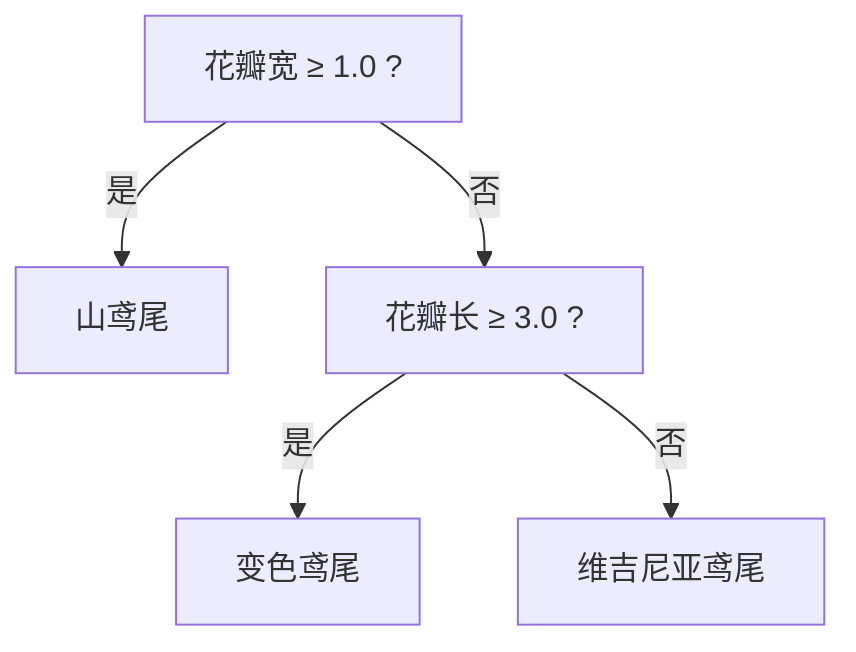

<!-- 片头 · 空镜 -->
## 手机认猫狗，外卖猜口味——智能从哪来？

---
layout: cover
---

# 第12讲 · 机器学习入门
## 决策树与 KNN

<!-- 讲者备注：【空镜】开场钩子。手机能认出照片里的猫狗、外卖猜你喜欢吃什么,这些"智能"从哪来?——让计算机从数据里学规律。本讲定位:理解原理直觉 + 会调库实现,不推数学公式。给两把枪:决策树(层层问问题)、KNN(物以类聚)。 -->

---
transition: slide-left
---

# 这一讲，你会收获五件事

- 机器学习 = 从数据中学规律
- 分类问题与监督学习
- 决策树：一层层问问题
- **KNN = K 值 + 距离 + 多数表决**
- sklearn 标准流程：划分→训练→预测→评估

<!-- 讲者备注：【全景】抛路线图,只给骨架。教学目标:学完能说明监督学习与分类;复述决策树决策过程;讲清 KNN 三大要素;用 sklearn 在 Iris 上跑通完整流程;理解维度/降维取舍。 -->

---
layout: section
---

## 第一幕 · 机器学习是什么

<!-- 转场
讲者备注：【转场】幕卡,淡入切幕。一句话预告本幕:先把"机器学习"和"分类问题"这两个词立起来,知道我们的目标是从特征学到标签的决策。 -->

---

# 机器学习：从数据中学规律


- **监督学习**：数据带标签，学"输入→标签"映射
- **无监督学习**：数据无标签，自己找结构（聚类）

<!-- 讲者备注：【全景】一句话定义机器学习,再加一张流水线图。重点区分监督(有正确答案标签)与无监督(没标签,自己找结构)。为后面决策树/KNN(监督)和 k-means(无监督)铺路。 -->

---

# 分类问题：从特征到标签

- **输入** → 特征 Feature（维度）
- **输出** → 类别标签 Label
- **目标** → 学会"特征→标签"的决策

> 给一个学生测 `身高`、`出勤` → 判断 `能/不能通过`

本讲学两类分类器：**决策树**、**KNN**

<!-- 讲者备注：【全景】把分类问题的骨架立起来:特征进、标签出、目标是学决策。用一个学生"身高+出勤→能否通过"的类比把特征与标签对起来。导流:下面两个算法都是干这件事。 -->

---
layout: section
---

## 第二幕 · 决策树

<!-- 转场
讲者备注：【转场】幕卡,淡入切幕。一句话预告本幕:决策树像连续做判断题,每步问一个特征是/否,不断分裂直到落到一个类别。可解释是它的王牌。 -->

---

# 决策树：一层层地问问题

判断一朵花品种：



- 内部节点 = 对**一个特征**提问；叶子 = 一个类别
- 自动挑"最能区分类别"的特征来问
- 王牌：**可解释**，看得懂"为什么这么分"

<!-- 讲者备注：【特写】决策树一眼看懂:一个特征一个判断题,是就走这、否就走那,层层过滤到叶子。强调两个点:树是自动从数据里长出来的(挑哪个特征),以及"可解释"这个独特价值——信贷审批/医疗诊断最怕黑箱,树能讲清理由。 -->

---
layout: section
---

## 第三幕 · KNN

<!-- 转场
讲者备注：【转场】幕卡,淡入切幕。一句话预告本幕:另一把更简单的枪——KNN。物以类聚:一个点靠近谁,它多半就是谁。三步走:算距离、找邻居、多数表决。 -->

---

# KNN：物以类聚，人以群分

> 一个点靠近谁，它多半就是谁


三步流程：

1. **算距离**：欧氏距离（常用）
2. **找邻居**：距离最近的 **K** 个点
3. **多数表决**：K 个里票多者胜

<!-- 讲者备注：【特写】KNN 三句话讲完:算距离、找邻居、多数表决。核心直觉是人以群分。配流程 mermaid 把三步骤可视化。告诉学生:KNN 没有"训练参数"的过程,训练就是记住数据,预测才算距离——这是它"懒"的地方。 -->

---

# ⭐ KNN 三大要素

| 要素 | 说明 | 注意 |
|---|---|---|
| **K 值** | 取几个邻居 | K 小→噪声敏感;K 大→过度平均 |
| **距离度量** | 怎么算"相近" | 最常用欧氏距离 |
| **多数表决** | K 个邻居投票 | 票多者胜 |

> **K 值 + 距离度量 + 多数表决** = KNN 的全部

- 常用 K = 3~10（奇数便于表决）
- K 太大 → 边界模糊；太小 → 过拟合

<!-- 讲者备注：【难点】KNN 的关键全在这张表。三个旋钮:选几个邻居(K)、怎么量最近(距离)、怎么定类(表决)。特别讲清 K 的取舍:K 太小被单点噪声带跑,太大把边界磨平。给一句收束:全算法就这三点,试 K 就是本讲超参数实验。 -->

---

# 手算一眼：新点靠近谁

```python
import numpy as np
new = np.array([1.7, 0.5])              # 待判断新点
d2 = np.sum((Xs - new) ** 2, axis=1)    # 欧氏距离平方
idx = np.argsort(d2)[:3]                # 取 k=3 最近邻居
print(d2[idx], ys[idx])                 # 距离 + 标签
# 三个邻居全为 0 → 多数表决预测 0（山鸢尾）
```

<!-- 讲者备注：【特写】把 KNN 落在代码上:算每个已知点到新点的距离平方、argsort 取最小 k 个、看标签投票。告诉学生这里 `Xs` 是两特征那两列,这就是"手算"过程的可视版。 -->

---
layout: section
---

## 第四幕 · sklearn 上手

<!-- 转场
讲者备注：【转场】幕卡,淡入切幕。一句话预告本幕:原理在手,用现成库一把跑通。scikit-learn 装好,加载 Iris,划分、训练、预测、评估,四步走。end_to_end 全流程。 -->

---

# sklearn：标准流程四步走

```python
from sklearn.datasets import load_iris
from sklearn.model_selection import train_test_split
from sklearn.neighbors import KNeighborsClassifier
from sklearn.metrics import accuracy_score

iris = load_iris()
X, y = iris.data, iris.target          # 150 样本 × 4 特征, 3 类
X_train, X_test, y_train, y_test = \
    train_test_split(X, y, test_size=0.3, random_state=42, stratify=y)

knn = KNeighborsClassifier(n_neighbors=5)
knn.fit(X_train, y_train)              # ① 训练
p = knn.predict(X_test)                # ② 预测
print(accuracy_score(y_test, p))       # ③ 评估
```

> 先 `fit` 再 `predict`——顺序别反

<!-- 讲者备注：【特写】端到端一遍过:加载→划分→学 KNN→预测→算准确率。强调 test_size 留出未见数据防"背答案"、stratify 保持类别比例、random_state 固定可复现。叮咛 fit 在前 predict 在后。 -->

---

# ⭐ K 值实验：调 k 看准确率

```python
for k in [1, 3, 5, 10, 20]:
    m = KNeighborsClassifier(n_neighbors=k)
    m.fit(X_train, y_train)
    print(f"k={k:<3} 准确率={accuracy_score(y_test, m.predict(X_test)):.3f}")
```

直观结论：

- k=1：单点决定，噪声敏感、可能尖峰
- k=5：通常最稳
- k=20：过度平均，准确率下降

> "调 k" 是本讲最典型的超参数实验

<!-- 讲者备注：【特写】把"选 K"变成一个能跑的实验:循环 K,看准确率怎么起伏。让学生亲手观察 k 太小/太大的曲线,体感过拟合与欠拟合。落点:k 就是一格超参数旋钮,调它就是在做超参搜索。 -->

---

# ❗ 维度转换：降维的取舍

- **维度 = 特征个数 = 坐标轴数**（Iris 4 维）
- 降维（如 `X[:, 2:]` 取花瓣两特征 → 2 维）便于可视化

| 特征数 | KNN 准确率 | 可解释/可视化 |
|---|---|---|
| 4 维全特征 | ~0.978 | 难想象 |
| 2 维花瓣 | ~0.933 | 好画散点 |

> 不是维度越多越好：维度多 → 计算大、易过拟合、难解释 → 降维要的是"看得懂"

<!-- 讲者备注：【难点】维度讲的不是玄学,是"特征个数=坐标轴数"。4 维想象不出、2 维能画图。给一张精度 vs 可解释的对照表:降维牺牲一点精度换"看得懂"。落点:维度多不是无敌,降维是工程取舍。 -->

---

# 常见错误：五个坑

| 想干嘛 | 坑 | 对的做法 |
|---|---|---|
| 用库 | 没装 sklearn | `pip3 install scikit-learn` |
| fit | X/y 不匹配报维度错 | 确认 shape 对齐 |
| 流程 | fit/predict 顺序反 | 先 fit 再 predict |
| 降维 | `X[:, 2:]` 切片写错 | 取第 3、4 列特征 |
| KNN 没训练过程 | 觉得怪 | KNN 训练=记数据 |

<!-- 讲者备注：【全景】五坑速查:没装库、维度不匹配、流程顺序反、切片错、KNN 懒训练看不懂。每个都给正解。让学生读数字时多想"为什么"。 -->

---

# 结课：你的 Python，会自己学规律了

> 监督学习学到标签，决策树层层问问题，
> KNN 物以类聚，K 值距离加表决，
> sklearn 四步走，划分训练预测评估——
> 从今天起，你的代码开始"会学习"。

🔜 下节预告：无监督学习与 k-means 聚类

<!-- 讲者备注：【空镜】收尾口诀 + 悬念。四句把监督学习、决策树、KNN、sklearn 四步一剑收束,点明这是"会学规律"的第一步。预告:下节讲无监督 k-means,数据没有标签,让机器自己分堆。致谢。 -->