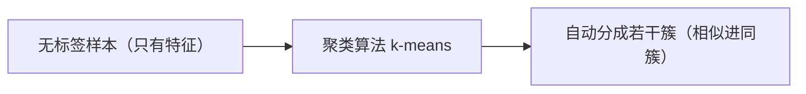
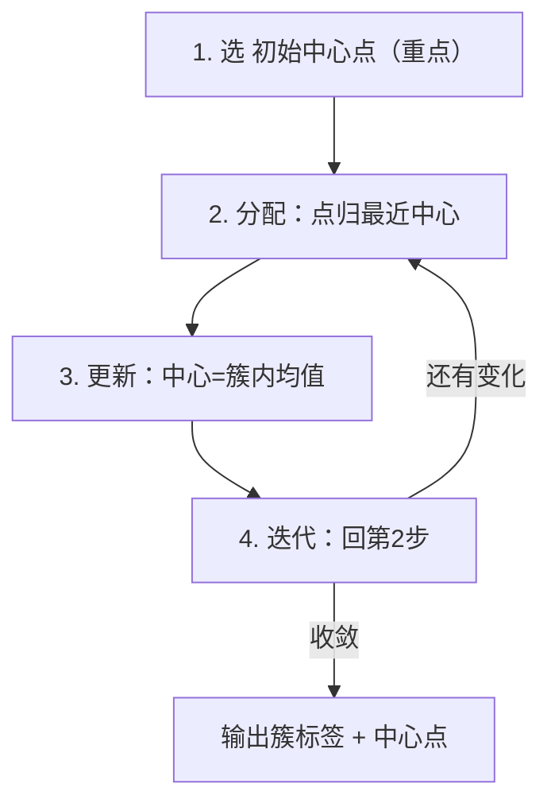

<!-- 片头 · 空镜 -->
## 没有答案，机器还能自己分群吗？

---
layout: cover
---

# 第13讲 · 无监督学习与 k-means
## 没标签，也能发现结构

<!-- 讲者备注：【空镜】开场钩子。上一讲分类问题答案都打好标签了;如果数据根本没有标签,能不能让相似的样本自动聚一起?——这就是无监督聚类。本讲一把枪:k-means。四步迭代(选中心→分配→更新→迭代)、初始中心点的影响、肘部法则选 K。 -->

---
transition: slide-left
---

# 这一讲，你会收获四件事

- 无监督 vs 监督学习
- k-means 四步迭代流程
- 初始中心点的影响（k-means++）
- 肘部法则选 K

<!-- 讲者备注：【全景】抛路线图,只给骨架。教学目标:学完能区分监督/无监督;复述 k-means 四步流程;分析初始中心点对结果的影响;用 sklearn 聚类并可视化;用惯性+肘部法则选 K。 -->

---
layout: section
---

## 第一幕 · 无监督学习

<!-- 转场
讲者备注：【转场】幕卡,淡入切幕。一句话预告本幕:先分清"有标准答案"(监督)和"自己找规矩"(无监督),再看聚类这个无监督任务怎么理解。 -->

---

# 监督 vs 无监督：有没有标签

| 维度 | 监督学习 | 无监督学习 |
|---|---|---|
| 训练数据 | **有标签**（答案已知） | **无标签**（只有特征） |
| 目标 | 学"输入→答案"映射 | 发现数据结构/分组 |
| 典型任务 | 分类、回归 | 聚类、降维、异常检测 |
| 典型算法 | KNN、决策树、回归 | **k-means**、DBSCAN |

> ⭐ 一句话：**有监督"有标准答案"，无监督"自己找规矩"**

<!-- 讲者备注：【全景】一张对照表把两流派分家,抓手只有一个:数据有没有标签。有标签学映射→监督;没标签找结构→无监督。列典型算法把上一讲(有监督)和本讲(无监督)对上。 -->

---

# 聚类：相似样本自动进同一簇

> 电影院想给观众分群，没有"答案"，只凭偏好特征



- **分类**：答案已知，教你怎么分
- **聚类**：答案未知，自己分

应用：顾客画像、新闻归类、图像压缩、异常检测

<!-- 讲者备注：【全景】聚类=自己把相似的点归一堆。用电影院观众分群的学生化类比建立直觉。再来一句聚类 vs 分类辨析:答案已知是分类,答案未知是聚类。给四个应用钉住现实价值:画像/归类/压缩/异常。 -->

---
layout: section
---

## 第二幕 · k-means 四步

<!-- 转场
讲者备注：【转场】幕卡,淡入切幕。一句话预告本幕:算法就四步——先选几个中心,再把点分给最近的中心,更新中心为簇均值,反复迭代到收敛。难点在"初始中心点"。 -->

---

# k-means：四步迭代流程



> 反复"分配 + 更新"，直到中心点基本不动 → 收敛

<!-- 讲者备注：【特写】四步流程画成自循环。分配:每个点归给最近中心;更新:中心漂移到这簇点的平均位置;再迭代。强调"收敛":中心变化很小就停。这张 mermaid 是本节课的主心骨。 -->

---

# 手算一步：中心会"漂移"

假设 K=2，`c1=(1,1)`、`c2=(8,8)`：

- 点 `(1.5,2)` 离 c1 近 → 归簇1
- 点 `(8.5,9)` 离 c2 近 → 归簇2

> 更新：簇1 新中心 = 簇1 所有点坐标的**平均**，不再等于原始 c1

```
# 中心点 c_next = mean(该簇所有点的坐标)
```

<!-- 讲者备注：【特写】用手算一个小例子感受"更新"。#1 初始中心,#2 分点,#3 中心变成均值(漂移)。核心一句话:中心点会漂到簇内点的均值位置,这才是"更新"。让同学口算一遍加深直觉。 -->

---

# ⭐ 原始中心点：从哪出发很关键

第 1 步选点不同 → 可能收敛到**不同**结果（局部最优）。

| 初始化 | 做法 | 特点 |
|---|---|---|
| 随机初始 | 随机选 K 个当中心 | 简便，但可能差解、不稳 |
| k-means++ | 让离已选中心远的点更可能当选 | 更稳更快，**sklearn 默认** |

```python
km = KMeans(n_clusters=2, n_init=10, random_state=42)  # 从10个初始点选最优
```

> 两次结果不同多半不是 bug，而是初始中心随机——设 `random_state`、加大 `n_init`

<!-- 讲者备注：【难点】把"为什么两次跑不一样"讲透:初始中心随机→局部最优。给初始化对照表:随机 vs k-means++。稳定三招:random_state 固定、k-means++ 默认、n_init 多初始取最优。这是学生最容易误以为写错 bug 的地方。 -->

---
layout: section
---

## 第三幕 · 跑起来 & 选 K

<!-- 转场
讲者备注：【转场】幕卡,淡入切幕。一句话预告本幕:代码一把跑通最小 k-means,再用惯性+肘部法则把"到底分几簇"这个 K 值定下来。 -->

---

# 最小 k-means：一把跑通

```python
import numpy as np
from sklearn.cluster import KMeans

X = np.array([[1, 1], [1.5, 2], [2, 1.5], [2.5, 2], [2, 3],
              [8, 8], [8.5, 8.5], [9, 8], [8.5, 9], [8, 9.5]])

km = KMeans(n_clusters=2, n_init=10, random_state=42)
km.fit(X)
print(km.labels_)             # 每点属于哪簇
print(km.cluster_centers_)    # 簇中心
print(km.inertia_)            # 惯性
print(km.predict([[9, 8.5]])) # 新点归哪簇
```

<!-- 讲者备注：【特写】10 个小点、两团、一行 fit。教学生读四个产物:labels 归属、cluster_centers 中心、inertia 惯性指标、predict 新点归类。这也是"只看标签不看中心"误区的正解:三条线一起看。 -->

---

# 肘部法则：K 怎么选

- K（簇数）要自己定
- 循环 K=1..7，记每个 K 的 `inertia_`（越小越紧凑）
- 画"K → 惯性"曲线，找**由陡变缓的拐点**

```python
K = range(1, 8)
inertias = [KMeans(n_clusters=k, n_init=10, random_state=42)
                 .fit(X).inertia_ for k in K]
# 打印/绘制，找肘部拐点
```

> 拐点像"胳膊肘"：过了它，多分一簇不再明显变好

<!-- 讲者备注：【特写】把选 K 变成一个可观察的曲线。K 越大惯性必越小,但拐点后收益骤减。肘部真相:增量收益断崖处,就是最划算的 K。让学生跑出来、画出曲线、自己点出拐点。 -->

---

# 常见错误：五个坑

| 想干嘛 | 坑 | 对的做法 |
|---|---|---|
| 区分监督/无监督 | 把聚类当分类 | 先问"有没有标签" |
| 两次结果不同 | 怀疑是 bug | 是初始中心随机，设 random_state |
| 距离计算 | 量纲大的特征主导 | 聚类前 `StandardScaler` |
| 选 K | 随手选 2 | 肘部法则 + inertia |
| 理解结果 | 只看标签 | 同时看 cluster_centers_ |

<!-- 讲者备注：【全景】五坑速查:聚类当分类、把随机初始当 bug、忘标准化、K 乱选、只看标签。每个都给学生一个可操作的修法。是实验报错与困惑的高发区。 -->

---

# 结课：没答案，也能发现问题结构

> 有标签是监督，没标签是无监督，
> k-means 四步：选中心分点更新迭代，
> 初始点随机、k-means++ 更稳，
> 肘部法则定 K，惯性帮你挑拐点。

🔜 下节预告：机器学习 —— 线性回归

<!-- 讲者备注：【空镜】收尾口诀 + 悬念。四句把监督/无监督、四步流程、初始中心、肘部法则一剑收束,点明"没标签也能找结构"的核心能力。预告:下节线性回归,从分类/聚类走到数值预测。致谢。 -->