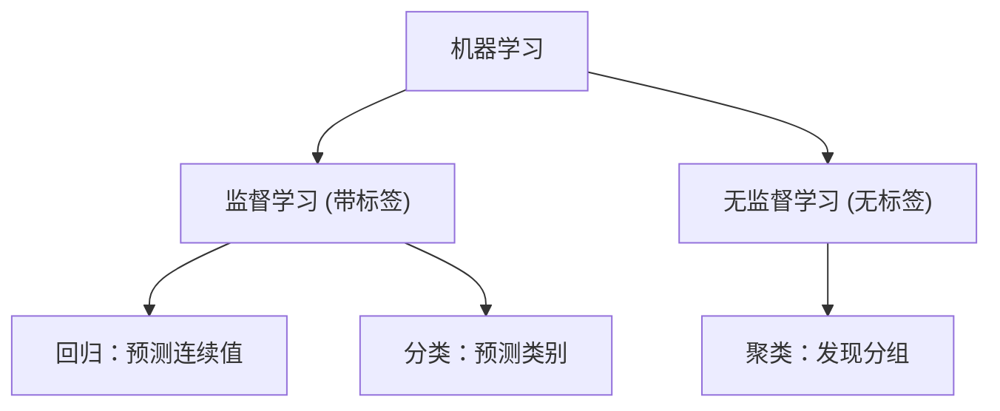
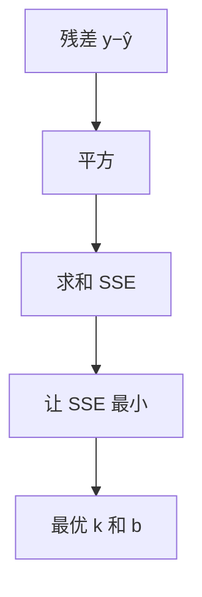

<!-- 片头 · 空镜 -->
## 房价会涨多少？让数据自己开口

---
layout: cover
---

# 第14讲 · 机器学习 · 线性回归
## 一条直线，把趋势画出来

<!-- 讲者备注：【空镜】开场钩子。给你几年房价,你能估明年一套新房卖多少吗?人靠"从历史找规律→预测";计算机也能。本讲用最直观的模型进入回归:线性回归 y=kx+b。给四件:意义、模型、最小二乘直觉、sklearn 五步。 -->

---
transition: slide-left
---

# 这一讲，你会收获四件事

- 机器学习 / 监督学习是什么
- 线性回归模型 `y = kx + b`
- 最小二乘：找最贴的直线
- sklearn 五步：装库→fit→读系数→predict→画图

<!-- 讲者备注：【全景】抛路线图,只给骨架。教学目标:学完能一句话说清监督学习并举例;写出 y=kx+b 并解释 k、b;理解最小二乘用"残差平方和最小"找直线;会用 LinearRegression 拟合、读 coef_/intercept_、predict 新样本。 -->

---
layout: section
---

## 第一幕 · 机器学习 & 监督学习

<!-- 转场
讲者备注：【转场】幕卡,淡入切幕。一句话预告本幕:先确position我们站在哪——监督学习、回归任务,数据带答案、预测连续数值。 -->

---

# 监督学习：数据带答案，预测连续数



- **监督**：训练数据带"答案"（标签）→ 回归 / 分类
- **无监督**：没答案，自己找结构 → k-means（第13讲）

> 线性回归是**监督学习**里的**回归**任务：预测一个**连续数值**

<!-- 讲者备注：【全景】把线性回归放进整个机器学习地图里。监督/无监督、回归/分类/聚类,一张树看懂。强调:回归=预测连续值(房价、温度),不是类别。给一句:数据带答案、预测连续数,这就是本讲坐标。 -->

---
layout: section
---

## 第二幕 · 模型与最小二乘

<!-- 转场
讲者备注：【转场】幕卡,淡入切幕。一句话预告本幕:用一条直线 y=kx+b 贴合散点的大趋势,而"最贴"的标准,就是让每个点到这条直线的距离平方和最小。 -->

---

# 数学模型：y = kx + b

- **k**：斜率 / 系数——x 每变 1，y 平均变多少
- **b**：截距——x=0 时的 y
- **ŷ**：模型预测值 `ŷ = k·x + b`

> ⭐ 目标：找到一组**最合适的 (k, b)**


<!-- 讲者备注：【特写】把直线三要素拆碎:k 斜率(x 每增 1 y 涨多少)、b 截距(x=0 的 y)、ŷ 预测。先立住"要找一对最好的(k,b)",这是全讲要回答的问题。 -->

---

# 最小二乘：残差平方和最小

- 每个点到直线的误差叫**残差**：`y − ŷ`
- 有正有负，直接相加会抵消 → 取**平方**
- 找 (k, b) 使残差平方和 **SSE 最小**



<!-- 讲者备注：【特写】把"怎么算最贴"讲成:量每个点到直线的竖直距离(残差)。为什么要平方?正负抵消、偏差大的重罚、且得到一个有唯一谷底的"碗"。落点:找那个把 SSE 压到底的 (k,b)。求导求零这种事交给库。 -->

---
layout: section
---

## 第三幕 · sklearn 五步

<!-- 转场
讲者备注：【转场】幕卡,淡入切幕。一句话预告本幕:原理在手,library 一把梭。装库、fit、读系数、predict、画图——五步走完,一条会预测的直线到手。 -->

---

# 五步：装库 → fit → 读系数 → predict → 画图

```python
import numpy as np
from sklearn.linear_model import LinearRegression

area  = np.array([50, 70, 80, 100, 120, 130, 150]).reshape(-1, 1)  # X 要二维
price = np.array([45, 62, 70, 88, 105, 112, 130])

model = LinearRegression()        # ① 选模型
model.fit(area, price)            # ② 训练（内部最小二乘求最优 k,b）
print("斜率 k =", model.coef_[0]) # ③ 读系数
print("截距 b =", model.intercept_)

new = model.predict([[95]])       # ④ 预测
manual = model.intercept_ + model.coef_[0] * 95   # ŷ=k·x+b 核对
print(new[0], "≈", manual)        # 两数一致 ✓
```

<!-- 讲者备注：【特写】端到端五步一次讲完。叮咛两个坑:X 必须二维 reshape(-1,1)、k 取 coef_[0]。用 predict 结果和手写 k·x+b 对一遍,让 student 亲眼信服 predict 就是在算直线。 -->

---

# 画出来：散点 + 拟合线

```python
import matplotlib.pyplot as plt
xs = np.linspace(40, 160, 100)
ys = model.intercept_ + model.coef_[0] * xs

plt.scatter(area, price, color='blue', label='原始数据')
plt.plot(xs, ys, color='red', label='拟合直线 y=kx+b')
plt.xlabel('面积 (㎡)'); plt.ylabel('价格 (万元)')
plt.title('房屋面积-价格 线性回归'); plt.legend(); plt.grid(True)
plt.show()
```

> 红色拟合线穿过多数蓝色散点——这就是"机器学到的规律"

<!-- 讲者备注：【特写】把学到的直线画出来,一眼看见"贴不贴"。散点蓝、直线红,一条大趋势。告诉学生:这条线就是模型的全部——看懂它,就看懂了线性回归。 -->

---

# 常见错误：五个坑

| 想干嘛 | 坑 | 对的做法 |
|---|---|---|
| 喂 X | 1D 数组报错 | `.reshape(-1, 1)` |
| 读系数 | 忘 k 是 `coef_[0]` | 核对 ŷ=kx+b |
| 用库 | 找不到 sklearn | `pip3 install scikit-learn` |
| 画图 | 图不显示 | 加 `plt.show()` |
| 理解截距 | 混淆 b 与 k | b 是 x=0 时的 y |

<!-- 讲者备注：【全景】五坑速查:1D 数组、coef_[0] 取错、没装库、plt.show 漏、k/b 混淆。每个都给正解。是实验报错高发区。 -->

---

# 结课：你已经会"用数据训练"了

> 监督学习带标签，回归预测连续数，
> 一条直线 y=kx+b，残差平方找最优，
> sklearn 五步一口气，画出来贴不贴——
> 你的 Python，训练的模型会预测了。

🔜 下节预告：神经网络（BP）做非线性拟合

<!-- 讲者备注：【空镜】收尾口诀 + 悬念。四句把监督回归、直线模型、最小二乘、sklearn 五步收束。预告:线性能画直线,遇到弯曲的数据怎么办?下节神经网络用非线性模型搞定。致谢。 -->