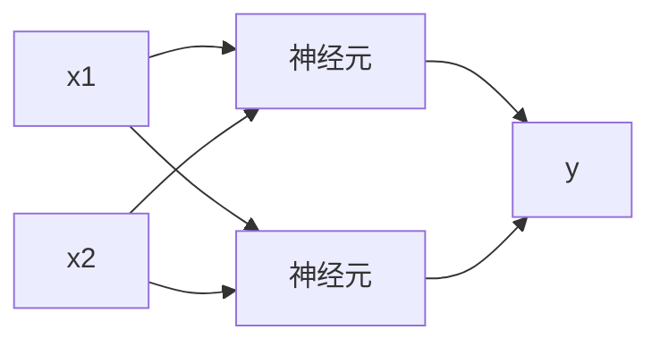
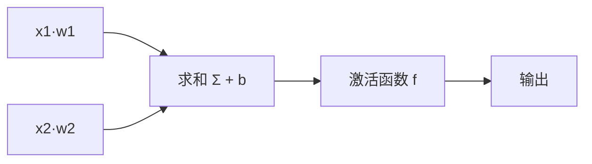
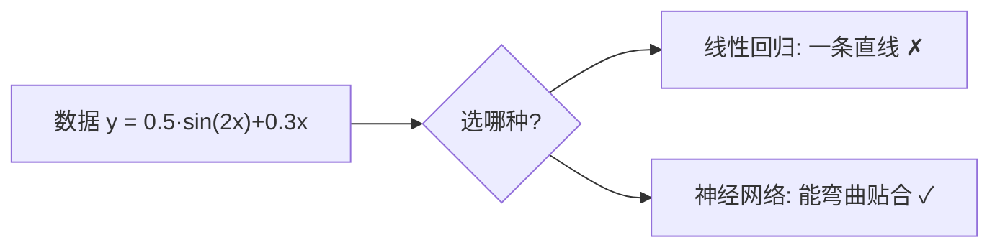

<!-- 片头 · 空镜 -->
## 刷脸解锁，认你的其实是一个神经网络

---
layout: cover
---

# 第15讲 · 神经网络与 BP
## 搭积木，拟合任何曲线

<!-- 讲者备注：【空镜】开场钩子。手机刷脸解锁,认你的背后是一个神经网络。本讲用最直给的方式讲神经网络:三结构要素、前向传播、BP 反向调权,最后用非线性拟合证明它"会弯曲"。思政线:人脸识别越强,隐私风险越大,技术与伦理并行。 -->

---
transition: slide-left
---

# 这一讲，你会收获四件事

- 神经网络结构：输入-隐藏-输出层
- 一个神经元 = 加权和 + 偏置 + 激活
- 前向传播 & BP 反向调权
- 非线性拟合：神经 nets vs 线性回归

<!-- 讲者备注：【全景】抛路线图,只给骨架。教学目标:学完能说清网络三结构要素与一个神经元干什么;一句话描述前向与 BP;用 numpy 实现非线性拟合并与线性回归对比;能分析隐藏数/学习率/激活函数影响;思考人脸识别隐私。 -->

---
layout: section
---

## 第一幕 · 结构

<!-- 转场
讲者备注：【转场】幕卡,淡入切幕。一句话预告本幕:先把"神经网络是什么、长什么样"立起来——一堆简单神经元搭积木式连起来,从数据里学模式。 -->

---

# 神经网络 = 搭积木

三个关键词：

- 一组**输入数据**（特征）
- 一组可调的**参数**（权重 + 偏置）
- 一个**非线性变换**（激活函数）

> 就像乐高：每一块都很简单，拼一起能搭出复杂结构

<!-- 讲者备注：【全景】一句话定义神经网络=搭积木学模式。三个关键词给到:输入特征、可调参数(权重偏置)、非线性激活。乐高比喻让"简单拼成复杂"落地。这是三结构要素的心智底座。 -->

---

# 三结构：输入 · 隐藏 · 输出



- **输入层** 🟦：接收特征
- **隐藏层**：加工 / 抽取特征
- **输出层** 🟩：给出结果

> 本讲示例：**1 → 16 → 1**

<!-- 讲者备注：【特写】三层一图看懂:输入接特征、隐藏加工、输出出结果。本讲网络是 1-16-1。强调隐藏层是"加工/抽取特征"的地方,下一讲深入多隐层。给图加留白,让学生先认层再数参。 -->

---

# 一个神经元：加权 + 偏置 + 激活



- **权重 w**：这条连接多重要（可学）
- **偏置 b**：偏移量，更灵活（可学）
- **激活 f**：加入非线性，如 `ReLU`、`tanh`

> 必须非线性！否则多层也等于一层，拟合不了曲线

<!-- 讲者备注：【特写】把一个神经元拆成三步:加权求和+偏置,再过激活函数。三个可学的东西 w、b,一个定非线性 f。重点解释"为什么非要非线性":全线性多层=一层,无法拟合曲线。这是本讲第一认知。 -->

---
layout: section
---

## 第二幕 · 前向与 BP

<!-- 转场
讲者备注：【转场】幕卡,淡入切幕。一句话预告本幕:数据怎么从输入传到输出(前向),以及误差怎么倒着传回去调整权重(BP)。看懂这两个方向,训练就懂了。 -->

---

# 前向传播：接力棒从前往后

1. 输入 `x` 进输入层
2. 隐藏层：`z = Σ w·x + b` → `a = f(z)`
3. 输出层：得 `y_pred`
4. 与真实 `y` 比 → 算**损失**

```python
z = x * w1 + b1     # 加权 + 偏置
a = tanh(z)         # 非线性激活
y_pred = a * w2 + b2   # 传到输出
```

<!-- 讲者备注：【特写】前向 = 信号按层一路传到输出。代码三行对应结构三要素:加权和、激活、输出。强调"_Pred 与真实 y 一比,损失就出来了"——这是训练的信号源。 -->

---

# BP：误差倒着传，谁错得多谁改得多

> 算出误差后，从输出端**倒着往回一层层传**——谁贡献的误差多，就多调谁的权重。

类比：传话游戏 / 小组分责任

1. **前向**：输入 → 预测 → 损失
2. **反向**：误差从输出往回传，求每个权重改多少
3. **更新**：`w = w − 学习率 × 梯度`
4. **重复** 到损失足够小

<!-- 讲者备注：【特写】BP 一句话公式给足,不推链式。核心:误差反向传、谁贡献多谁改多。给传话/小组分责的类比让责任分摊有直觉。列四步学习循环:前向→反传→更新→重复。这是训练的整个心跳。 -->

---

# 为什么线性"学不动"曲线？

- 线性回归：只能画**一条直线**
- 神经网络：靠激活的**非线性**，能拼出任意曲线



> 本讲演示要证明的，正是这张图

<!-- 讲者备注：【特写】给一个曲线型目标函数,对比两模型:直线贴不上、网络能弯。这一页把"为什么引入神经网络"讲成一道选择题。落点:激活函数的非线性=弯曲能力=能拟合曲线。 -->

---
layout: section
---

## 第三幕 · 上手机器 & 思政

<!-- 转场
讲者备注：【转场】幕卡,淡入切幕。一句话预告本幕:用 numpy 手写 1-16-1 网络证明确实比线性回归小 200 倍误差,再踩几个坑学会调参;最后落到人脸识别的隐私伦理。 -->

---

# 跑通 1-16-1：numpy 手写 MLP

```python
class MLP:               # 1 -> 16 -> 1
    def __init__(self):
        self.w1 = np.random.randn(1, 16)*np.sqrt(2.0)
        self.b1 = np.zeros((1, 16));  self.b2 = np.zeros((1,1))
        self.w2 = np.random.randn(16, 1)*np.sqrt(2.0/16)
    def forward(self, X):
        z1 = X @ self.w1 + self.b1
        self.a1 = np.tanh(z1)               # 激活
        return self.a1 @ self.w2 + self.b2  # 输出
    def backward(self, X, y):  ...          # 反传 + 更新
# 训练 5000 轮
for epoch in range(5000):
    y_pred = net.forward(X); loss = ((y_pred-y)**2).mean()
    net.backward(X, y)
```

<!-- 讲者备注：【特写】演示代码主结构给到:MLP 类里 forward 算隐藏输出、backward 反传更新。训练循环 5000 轮。不推公式,只让 student 看懂"前向→反传→更新→再前向"这个循环。这是第 11 讲 train()/predict() 封装思路的完整落地。 -->

---

# 🔥 结果：神经网络碾压线性回归

| 模型 | 最终均方误差 |
|---|---|
| 线性回归（一条直线） | ≈ 0.34 |
| 神经网络（1-16-1） | ≈ 0.001 |

- 误差小 **200 多倍** → 真学会曲线了
- 损失一路下降 → 训练有效；震荡/`nan` → 学习率太大

> 改隐藏数调弯曲能力，改学习率调收敛快慢

<!-- 讲者备注：【特写】数字最有力:0.34 vs 0.001,小两百倍。解读:学了曲线不是画直线。再教会看损失曲线学会排错:nan/震荡=学习率太大。给两个旋钮:隐藏数管弯曲、学习率管快慢。 -->

---

# 故意踩坑：学会看报错

- `loss` 变 `nan` → 学习率太大，权重冲出边界 → 用 `0.001`
- shape 对不上 → 矩阵维度不匹配 → 检查 reshape
- 没装 sklearn → 用 numpy 手写版兜底

> **一次只调一个参数，控制变量** —— 改隐藏数就别同时动学习率

<!-- 讲者备注：【特写】把最常见的三个报错点成靶子:nan(学习率)、维度不匹配、没装库。纪律最重要一句:一次只调一个参数。让 student 养成控制变量的实验习惯。 -->

---

# ✨ 思政：人脸识别的两面

- **好**：安防、支付、便捷解锁
- **险**：人脸不可更改，像密码被泄露就得改；可能被滥用

工程师可以做的：

- 收集前**明确告知 + 征得同意**
- 只采集**最小数据**，加密存储
- 遵守《个人信息保护法》，及时销毁

> 技术越强大，越要跑在安全和伦理的轨道上

<!-- 讲者备注：【思政】收票房:人脸这种生物数据不可改,一旦泄露代价极高。给工程师三条行动准则:告知同意、最小数据+加密、合规销毁。落点一句:技术多强,伦理就多重要。这是收尾的价值观钩子。 -->

---

# 结课：误差倒着传，谁错得多谁改得多

> 神经网络搭积木，输入隐藏输出层，
> 加权偏置加激活，非线性才弯曲，
> 前向得预测、BP 反着调权重，
> 技术再强，也别丢了安全和伦理。

🔜 下节预告：期末课程设计 + 总复习

<!-- 讲者备注：【空镜】收尾口诀 + 悬念。四句把结构、神经元、前向/BP、非线性收束,点出隐私伦理的思政落点。预告:下节布置期末课程设计并总复习全课。致谢。 -->