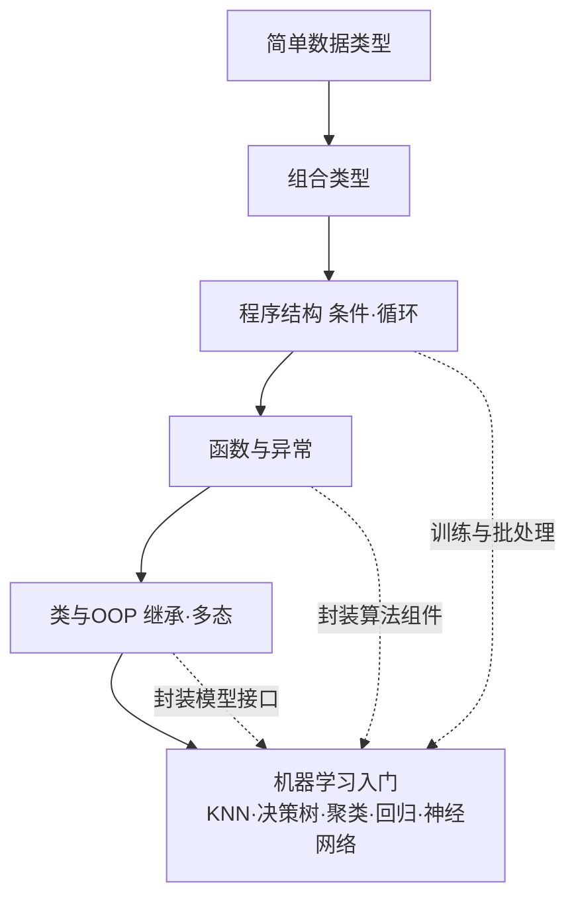

<!-- 片头 · 空镜 -->
## 十六讲学完，用一学期换一个"毕业作品"

---
layout: cover
---

# 第16讲 · 期末课程设计 + 总复习
## 收好每一条复习线索，交出你的作品

<!-- 讲者备注：【空镜】开场钩子。期末课程设计占 60%,是本学期的"毕业作品"。本讲两件事:把"怎么交"讲清楚,把"会什么"串起来。节奏:先给成绩怎么来的→一图看全课→六条复习线索→课程设计全套要求。 -->

---
transition: slide-left
---

# 这一讲，你会收获四件事

- 成绩怎么来：期末课程设计 **60%**
- 全课一图看清 + 六条复习线索
- 算法速辨：有没有标签 × 类别还是数值
- 课程设计全套要求：题材选题质量报告

<!-- 讲者备注：【全景】抛路线图,只给骨架。教学目的:串讲全课形成知识图谱;理解课程设计全部要求(题材/选题/质量/报告/诚信/评分/时间线);会搭最小流水线骨架;完成初步选题。 -->

---
layout: section
---

## 第一幕 · 成绩与全景

<!-- 转场
讲者备注：【转场】幕卡,淡入切幕。一句话预告本幕:先算清成绩构成,期末设计占大头;再一图看全课,把16讲数据载体和机器学习串起来。 -->

---

# 成绩怎么来：期末设计占 60%

| 构成 | 占比 | 方式 |
|---|---|---|
| 出勤 | 10% | 考勤点名 |
| 平时 | 30% | 小测、作业、表现 |
| **期末课程设计** | **60%** | Python 智能图像处理项目 |

> 期末是大头、是综合应用——这节课告诉你怎么交

<!-- 讲者备注：【全景】成绩一张表讲清。期末 60% 是绝对主战场,把它定位成"16 讲的综合应用"而非临时抱佛脚。让学生心理有数:这节课的内容 = 交作业的方法。 -->

---

# 一图看全课：数据载体 → 机器学习



> 五块语法主干，各自"喂料"给机器学习那一环

<!-- 讲者备注：【全景】全课一张图收口。实线是语法递进,虚线是每块对机器学习的贡献:数据载体、批量映射、批处理、封装组件、封装接口。让学生指着图说出"哪讲学的是哪个方块"。 -->

---
layout: section
---

## 第二幕 · 六条复习线索

<!-- 转场
讲者备注：【转场】幕卡,淡入切幕。一句话预告本幕:六条线索每条配一个记忆点,快速过一遍"学了什么"。重在速记,不在深讲。 -->

---

# 线索①②：类型

- **简单类型**：int/float/str；`input()` 得到的是**字符串**要转换；分片 `s[::-1]` 逆序
- **组合类型**：

| 类型 | 特征 | 角色 |
|---|---|---|
| list | 有序、可变 | 批量存样本/损失 |
| tuple | 有序、不可变 | 多值/坐标 |
| set | 唯一 | 去重 |
| dict | 键值映射 | 配置/词频 |

> 记忆点：分片逆序；input 要转；列表可变元组不可变、集合去重、字典靠 key

<!-- 讲者备注：【全景】两条类型线索一口气给完。数据类型重在"input 要转 + 分片";组合类型一张小表列四种,各自在项目里端什么角。给记忆点收口。 -->

---

# 线索③④：结构与函数

- **程序结构**：`if/elif/else` 分支、`for/while` 循环、`break/continue`；循环 = 批处理核心
- **函数与异常**：`def`、位置/关键字/默认/可变参数、`lambda`、内置函数、`try/except/finally`

```python
for path in image_paths:      # 批处理骨架
    if is_valid(path):
        data.append(load(path))
        if len(data) >= limit:
            break
```

> 记忆点：循环是批处理的核心逻辑；模块化靠函数、健壮性靠异常

<!-- 讲者备注：【全景】线索三四并讲:结构(分支循环)和函数/异常。给一段"读图列表+条件过滤+break 限流"的骨架,把循环+条件+流程控制一次复用。记忆点:循环=批处理,函数=模块化,异常=健壮。 -->

---

# 线索⑤⑥：类 & 机器学习

```python
class ImageClassifier:            # 封装"读图→预处理→建模→预测"
    def __init__(self, model):
        self.model = model
    def train(self, X, y):        # 公有方法：训练
        self.model.fit(X, y)
    def predict(self, X):         # 公有方法：预测
        return self.model.predict(X)
```

- **面向对象**：构造器、继承、多态、公有/私有 → 封装成可复用接口
- **机器学习**：监督(KNN/决策树/回归) vs 无监督(k-means) vs 神经网络 BP

> 记忆点：用类把"读图→预处理→建模→预测"封装成接口

<!-- 讲者备注：【特写】线索五六收口到课程设计最实用的一处:用 ImageClassifier 类把训练预测封装进接口,再接到机器学习那一环。这正好是第11/14讲 model.fit/predict 思路的期末版。 -->

---

# ⭐ 算法速辨：两问定模型

| 问题 | 有无标签 | 预测目标 | 算法 |
|---|---|---|---|
| 猫狗分类 | 有 | 类别 | KNN / 决策树 |
| 预测房价 | 有 | 数值 | 线性回归 |
| 图片自动分组 | 无 | 组别 | k-means |
| 非线性拟合 | 有 | 数值/类别 | 神经网络 BP |

> 两问辨算法：**有没有标签？要预测的是类别还是数值？**

<!-- 讲者备注：【难点】把全课算法收成一张"两问定模型"的速查表。看有没有标签、看要类别还是数值,四个格子对应 KNN/回归/k-means/神经网络。这是课程设计"选模型"环节的指南针。 -->

---
layout: section
---

## 第三幕 · 课程设计全套要求

<!-- 转场
讲者备注：【转场】幕卡,淡入切幕。一句话预告本幕:把期末设计的"怎么定题、做到多好、报告写啥、诚信红线、什么时间交"一层层讲清。 -->

---

# 最小流水线骨架：三行可跑

```python
import numpy as np
from sklearn.neighbors import KNeighborsClassifier
from sklearn.model_selection import train_test_split

X = np.random.rand(50, 4)          # ① 特征矩阵
y = np.array([0, 1] * 25)          #    标签
Xtr, Xte, ytr, yte = train_test_split(X, y, test_size=0.2)  # ② 拆分
knn = KNeighborsClassifier(n_neighbors=3)
knn.fit(Xtr, ytr)                  # ③ 训练
print("准确率:", knn.score(Xte, yte))  #    评估
```

> 课程设计 = 把骨架换成"真实图像 + 你的主题 + 合适模型"

<!-- 讲者备注：【特写】期末的最小起点:读特征→拆分→训练→评估,一行行可跑。告诉学生:你的项目就是在这个骨架上,把 np.random.rand 换成一堆真实图像、把模型换合适、把评估做完整。 -->

---

# 定题 & 质量

**题材**：numpy / sklearn / opencv 的智能图像处理项目

**主题三档**：
- 🔵 应用型：边缘检测、直方图均衡、去噪、增强
- 🟡 进阶型：KNN/决策树做手写数字、简单物体分类
- 🔴 创新型：结合光电/通信/电气专业的智能图像应用（鼓励）

**质量**：功能完整、至少"预处理 + 一个模型"两段、有一定工作量、代码规范

> 检查清单：能否说清"做了什么、用了哪几讲的知识、为什么这么做"？说不清→太重或太简

<!-- 讲者备注：【全景】定题给三档难度、质量给四把尺。给学生一个自查钩子:能不能说清用了哪几讲的知识。这是检验"综合运用"最直接的问题。 -->

---

# 报告 · 诚信 · 时间线

- **报告**：题目背景→需求→技术方案→实现→结果→总结，按参考模板写
- **诚信（红线）**：**独立完成，抄袭 / 雷同判 0 分**
- **时间线**：本讲 1 周内交《选题说明表》 → 自主开发 → 期末答辩/点评 → 打包提交

| 项目 | 内容 |
|---|---|
| 选题 | 本讲课后 1 周，交一页《选题说明表》 |
| 开发 | 课后至截止日自主完成 |
| 报告+代码 | 按公告命名约定打包提交 |
| 答疑 | 课程群 + 答疑时间 |

<!-- 讲者备注：【全景】三件套一次交代:报告按模板写、诚信是红线、时间线四步走。诚信不是空话,抄袭/雷同直接 0 分,务必独立。时间线让学生对"现在该干嘛"有数:先交选题表。 -->

---

# 结课：这是你的"毕业作品"

> 五块语法主干，六条复习线索，
> 两问定模型，看看标签看目标，
> 最小流水线三行跑，再难也一节节啃——
> 用一学期的 Python 与机器学习，解决一个真实的小问题。

🎉 祝大家顺利收官！

<!-- 讲者备注：【空镜】收尾升华。把期末设计定位成"16 讲的毕业作品":语法主干是砖、机器学习是料、最小流水线是搭法。鼓励他们用所学解决一个真实小问题。致谢,收课。 -->