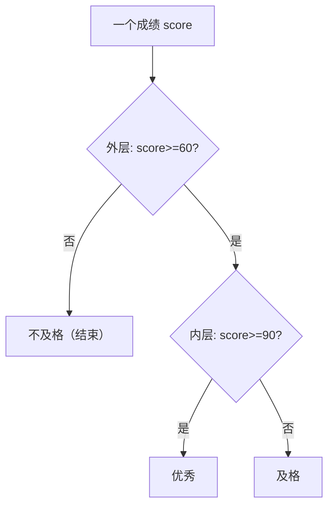

> Python应用程序设计(B) · 四、语法——程序结构 · 总时长 90 分钟（含上机实践）· 零基础适用

## 一、本讲导览

| 环节 | 内容 | 时长 |
|---|---|---|
| 回顾/导入 | 05 集合字典回顾 + 开场提问 | 8 |
| 环节一 | 三种分支基本语法（`if`/`else`/`elif`） | 15 |
| 环节二 | 缩进 = 代码块 | 10 |
| 环节三 | 嵌套分支（外层抓大类） | 15 |
| 环节四 | `elif` 的隐含条件（难点） | 15 |
| 随堂练习 | 分支口答 + 成绩判定预判 | 7 |
| 上机实践 | 比大小 + 成绩等级 | 15 |
| 小结 + 作业 | HW06 · 下讲预告 | 5 |

---

# 学习目标

学完本节后，你能够：

- 写出单条件、双条件、多条件三种分支程序
- 用 `elif` 处理多分支，并理解其**隐含条件**
- 正确使用缩进组织嵌套分支
- 独立完成"比大小""成绩等级判定"两个实验

---

## 二、回顾与导入（8 分钟）

**回顾上一讲（05 集合与字典）：**
> 上一讲我们把数据"打包"进了集合和字典。今天问题更进一步：程序怎么根据条件**走不同的路**？

**开场提问：**
> "如果成绩 ≥90 显示'优秀'、否则显示'及格'，程序该怎么二选一？"

先给一个对比概念：很多语言用 `{}` 界定一段代码属于谁，而 Python 用**缩进**。这一讲的关键，就是搞懂"**缩进 = 代码块**"。

---

# 语法快带过：三种分支（1）

**单条件分支 `if`**

```python
age = 20
if age >= 18:
    print("成年")      # 缩进的这行属于 if 块
```

**双条件分支 `if-else`**

```python
n = -5
if n >= 0:
    print("非负数")
else:                # else 条件 = if 不成立，不用再写判断
    print("负数")
```

---

# 语法快带过：三种分支（2）

**多条件分支 `if-elif-else`**

```python
score = 85
if score >= 90:
    grade = "优秀"
elif score >= 80:
    grade = "良好"
elif score >= 70:
    grade = "中等"
elif score >= 60:
    grade = "及格"
else:
    grade = "不及格"
print(grade)      # 输出：良好
```

- 从上到下**依次判断**，命中第一个成立的分支即停止
- 关键字是 `elif`，不是 `else if`

---

# 缩进 = 代码块 ⭐

别的语言常用 `{}` 界定块，**Python 用缩进**——缩进相同的一整块，属于同一段代码。

```
if 条件:
    缩进的语句 ……  # 属于 if 块
    缩进的语句 ……  # 仍属于 if 块
不缩进的语句 ……     # 已离开 if 块
```

- 块内统一 4 个空格（不要混用 Tab）
- 缩进错了 → `IndentationError`，或**逻辑错位**（不报错但结果错误，更危险）

---

# 为什么强调嵌套规则 ⭐

真实选择往往不止一层。**层次怎么定？**

> My 原则：外层抓"大类"，内层做"细分"。



---

# 嵌套分支写法（重点⭐）

外层判断"是否及格"，内层再细分等级：

```python
score = 88
if score >= 60:            # 外层：抓大类
    if score >= 90:        #   内层：细分
        grade = "优秀"
    elif score >= 80:
        grade = "良好"
    else:
        grade = "及格"
else:
    grade = "不及格"
print(grade)     # 输出：良好
```

**层次顺序：** 先定外层大条件，再逐层往内细化条件，每层缩进 +4 空格。

---

# 难点：elif 的隐含条件 ⚠️（1）

**误区：把每个 elif 当独立 if，重复判断前置条件**

```python
score = 85
if score >= 90:
    grade = "优秀"
elif score >= 60 and score < 90:   # ❌ 多写了 score >= 60 (score<90)
    grade = "及格"
```

预期 85 → "及格"，实际正确吗？——**逻辑能对，但写法冗余、易错**。

---

# 难点：elif 的隐含条件 ⚠️（2）

**正解：自 `if` 之后，逐层 `elif` 已隐含"前面都不成立"**

```python
if score >= 90:
    grade = "优秀"
elif score >= 80:
    grade = "良好"     # 到这里已隐含 score < 90
elif score >= 60:
    grade = "及格"     # 隐含 score < 80
else:
    grade = "不及格"   # 隐含 所有前置都不成立，即 score < 60
```

> 结论：`elif` 判断的是**本层**条件，不必也无须叠加写前置条件——这是它省代码、清爽的原因。

---

# 常见错误

| 错误 | 原因 | 正确做法 |
|---|---|---|
| `IndentationError` | Tab/空格混用、层级错乱 | 统一 4 空格缩进 |
| 逻辑错位不报错 | 该缩进的行没缩进，掉出 if 块 | 检查缩进层级 |
| `elif` 重复判断前置条件 | 把 elif 当独立 if | 直接写本层条件，依赖隐含条件 |
| 想写 `else if` 却报错 | 带进来其它语言的写法习惯 | Python 用 `elif` |
| 边界 `>=` vs `>` 用错 | 未考虑等于情况 | 设计测试用例验证两端取值 |

---

# 实验1：比大小

输入两个数，判断大小关系。

```python
a = float(input("请输入a: "))
b = float(input("请输入b: "))
if a > b:
    print(f"{a} > {b}")
elif a == b:
    print(f"{a} == {b}")
else:
    print(f"{a} < {b}")
```

测试：`(5,8)`、`(8,8)`、`(9,2)` 三种都应输出正确。

---

# 实验2：成绩等级自动判定

输入百分制成绩，判定等级。

```python
score = float(input("请输入成绩(0-100): "))
if score >= 90:
    grade = "优秀"
elif score >= 80:
    grade = "良好"
elif score >= 70:
    grade = "中等"
elif score >= 60:
    grade = "及格"
else:
    grade = "不及格"
print(f"等级：{grade}")
```

> 边界值思考：恰好 90 / 89.9 / 60 / 59 各输出什么？

---

## 随堂练习（7 分钟）

1. **口答**：`score = 85`，用 `if-elif-else` 会输出什么等级？
2. **手写**：`if a > 0:` 下面一行语句需要怎样缩进？不缩进会怎样？
3. **预判**：下面的 `elif` 有没有多余的前置条件？
   ```python
   if score >= 90: ...
   elif score >= 60 and score < 90: ...
   ```

## 上机实践（15 分钟）

- 🔵 基础：完成「比大小」+「成绩等级判定」两个实验
- 🟡 进阶：三数比大小；用 `elif` 精简多条件代码
- 🔴 挑战：考勤 + 成绩"双维度"复合判定，用三种写法并对比

提交要求：三个典型测试用例的运行截图 + 关键代码；先跑通基础实验。

---

# 思考点

> 如果条件很复杂，需要嵌套条件，应该**如何按照层次编写**？

1. 嵌套的先做什么、后做什么？外层管什么？
2. 什么时候用嵌套，什么时候用 `elif` 并列？
3. 写嵌套代码时，如何防止缩进层数失控？

---

## 小结 + 作业

- 本课要点：`if/elif/else`、缩进=代码块、**嵌套分层**（外层抓大类）、**elif 隐含条件**
- 作业：完成 HW06 → [第6讲作业](../assignments/hw06.md)
- 下次课：**循环结构**（for / while）
- 预习：循环结构；把条件结构和集合/字典结合起来想

> 判断帮你"开岔路"，下一步学习"反复走同一条路" 🧭